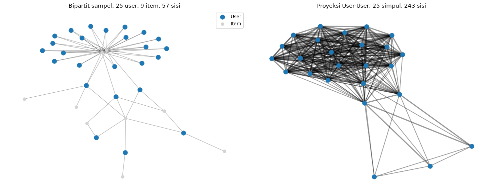
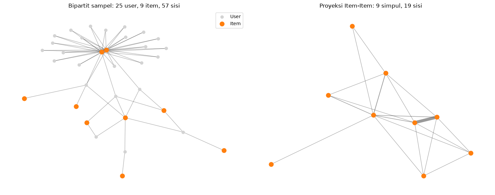
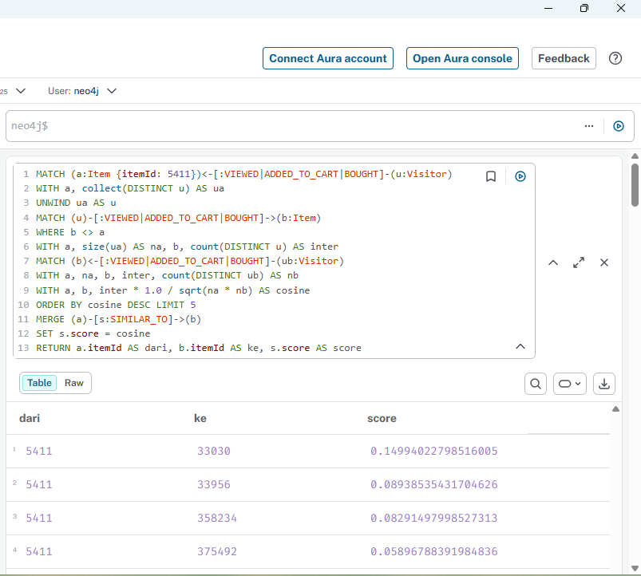
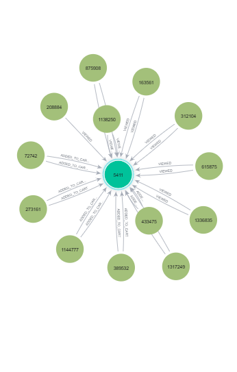
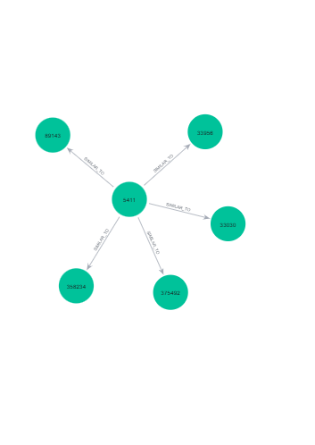
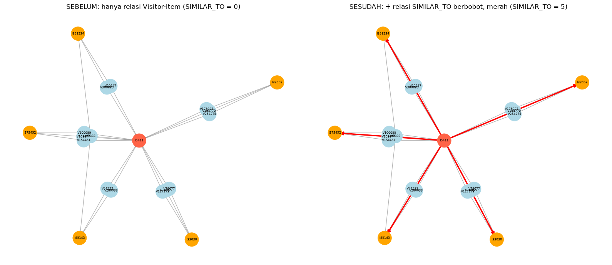

# UTS Graf Sains Data: Python Driver Neo4j dan Rekomendasi

| | |
|---|---|
| **Nama** | Nani Fitria Ramadhani |
| **NIM** | 23031554013 |
| **Kelas** | Graf Sains Data 2023B |
| **Program studi** | S1 Sains Data, FMIPA, Universitas Negeri Surabaya |
| **Mata kuliah** | Graf Sains Data 2023B |
| **Dataset** | [RetailRocket e-commerce dataset](https://www.kaggle.com/datasets/retailrocket/ecommerce-dataset) (Roman Zykov) |

## Daftar isi
1. [Struktur repositori](#struktur-repositori)
2. [Cara menjalankan](#cara-menjalankan)
3. [Fold data](#fold-data)
4. [Tugas Pendahuluan](#1-tugas-pendahuluan)
5. [Soal 2.1 Wrangling dan EDA](#21-wrangling-dan-eda)
6. [Soal 2.2 Analytics](#22-analytics)
7. [Kesimpulan dan keterbatasan](#kesimpulan-dan-keterbatasan)

---

## Struktur repositori

```
.
├── README.md
├── UTS_Graf_Sains_Data_23031554013_Nani_Fitria.ipynb   # seluruh kode dan output
├── images/                                             # screenshot Neo4j Browser dan plot
│   ├── perhitungan_similarity.png
│   ├── sebelum_similarity.png
│   ├── sesudah_similarity.png
│   ├── networkx_vsm_user.png
│   ├── networkx_vsm_item.png
│   └── networkx_sebelum_sesudah.png
└── dataset/                                            # tidak diunggah
    ├── events.csv
    ├── events_train.csv
    └── events_test.csv
```

> `events.csv` (±2,76 juta baris) dan hasil filternya tidak diunggah karena ukurannya besar. Unduh dataset asli dari Kaggle, lalu jalankan notebook untuk membuat `events_train.csv` dan `events_test.csv`.

## Cara menjalankan

1. **Environment** (venv atau uv, Python 3.10), lalu pasang paket `neo4j` (5.x), `pandas`, `scipy`, `scikit-learn`, `networkx`, `matplotlib`, `tqdm`, dan `ipykernel`. Driver 5.x dipakai karena `execute_query` pada tutorial 1.2 tidak tersedia di driver 4.2.1.
2. **Dataset**: unduh `ecommerce-dataset.zip` dari Kaggle, ekstrak, dan letakkan `events.csv` di folder `dataset/`.
3. **Neo4j** 5.x berjalan di `bolt://localhost:7687`. Plugin GDS atau APOC tidak diperlukan.
4. **Notebook**: buka di VS Code, pilih kernel dari environment tersebut, sesuaikan `AUTH` dan `DATA_DIR` pada sel konfigurasi, lalu jalankan dari atas ke bawah.

> Sel impor memiliki saklar `RESET`. Jika `True`, seluruh isi database dihapus sebelum impor. Jalankan impor **satu kali** pada database yang bersih, karena relasi dibuat dengan `CREATE` sehingga impor berulang tanpa `RESET` menggandakan relasi.

## Fold data

Format tanggal pada tabel pembagian data adalah bulan/hari/tahun. Timestamp dalam milidetik dan dikonversi ke UTC. Batas akhir bersifat inklusif (sampai 23:59:59).

| Fold | Mulai | Hingga | Durasi |
|---|---|---|---|
| Training (P1) | 2 Mei 2015 | 2 Juli 2015 | 62 hari |
| Testing (P2) | 11 Juli 2015 | 26 Juli 2015 | 16 hari |

Terdapat jeda 8 hari (3-10 Juli 2015) di antara keduanya. Hanya fold training yang dimuat ke graf Neo4j. Fold testing dipakai sebagai ground truth evaluasi (Hit@5 dan NDCG@5).

---

## 1. Tugas Pendahuluan

### 1.1 Persiapan lingkungan
Environment dibuat dengan `venv`/`uv`, dan driver Neo4j 5.x dipakai (alasannya pada bagian [Cara menjalankan](#cara-menjalankan)). Koneksi ke Neo4j diverifikasi dengan `driver.verify_connectivity()` dan menghasilkan "Terhubung ke Neo4j".

### 1.2 Driver Neo4j: jawaban pertanyaan checkpoint
1. **Nama database:** `neo4j` (argumen `database_="neo4j"`).
2. **Akses database lain dalam satu instance:** dengan parameter `database_="nama_db"` pada `execute_query`, atau `driver.session(database="nama_db")`. Pada Cypher/Neo4j Browser dengan `:use nama_db`.
3. **Jenis graf pertemanan:** graf berarah (`KNOWS` memiliki arah), satu jenis simpul (`Person`), satu jenis relasi, tanpa bobot, berbentuk bintang dengan Arthur di pusat.

### 1.3 Impor data RetailRocket
`events.csv` memuat kolom `timestamp` (unix epoch, milidetik), `visitorid`, `event` (`view`, `addtocart`, `transaction`), `itemid`, dan `transactionid`.

Fold training diimpor secara batch (ukuran batch 5.000 baris, 249 batch) dengan `UNWIND`. Simpul `Visitor` dan `Item` dibuat dengan `MERGE`, sedangkan relasi dibuat dengan `CREATE` sesuai jenis event:

| Event | Relasi |
|---|---|
| `view` | `(:Visitor)-[:VIEWED {timestamp}]->(:Item)` |
| `addtocart` | `(:Visitor)-[:ADDED_TO_CART {timestamp}]->(:Item)` |
| `transaction` | `(:Visitor)-[:BOUGHT {timestamp, transactionId}]->(:Item)` |

Constraint keunikan dibuat pada `Visitor.visitorId` dan `Item.itemId`. Selama impor, Neo4j menampilkan peringatan *deprecation* ("CALL subquery without a variable scope clause"). Peringatan ini tidak memengaruhi hasil.

---

## 2.1 Wrangling dan EDA

### No. 1-2 Filter periode dan simpan CSV

Filter diterapkan pada kolom `timestamp` (dikonversi ke datetime UTC), lalu disimpan ke `events_train.csv` dan `events_test.csv`. Data asli: 2.756.101 baris, rentang 3 Mei 2015 03:00 sampai 18 September 2015 03:00 (UTC).

| | Baris | Visitor unik | Item unik | `view` | `addtocart` | `transaction` |
|---|---|---|---|---|---|---|
| Train | 1.243.222 | 627.439 | 165.655 | 1.202.807 | 30.411 | 10.004 |
| Test | 369.601 | 210.215 | 89.680 | 358.089 | 8.707 | 2.805 |

### No. 3 Komposisi subgraph

Query Cypher dijalankan melalui Python API (`driver.session(database=DB)`, `s.run(...)`, `.data()` menjadi `DataFrame`):

```cypher
MATCH (n) RETURN labels(n)[0] AS jenis_simpul, count(n) AS jumlah;
MATCH ()-[r]->() WHERE type(r) <> 'SIMILAR_TO'
RETURN type(r) AS jenis_relasi, count(r) AS jumlah ORDER BY jumlah DESC;
```

- `MATCH (n)` mengambil semua simpul, `labels(n)[0]` memberi jenis simpul, dan `count(n)` menghitung jumlahnya. Karena `labels(n)[0]` adalah kolom non-agregat, hasilnya dikelompokkan per jenis simpul.
- `MATCH ()-[r]->()` mengambil semua relasi berarah, `type(r)` memberi jenis relasi, dan relasi `SIMILAR_TO` dikecualikan karena dibuat pada No. 7b, bukan hasil impor.

| Jenis simpul | Jumlah | Persentase |
|---|---|---|
| Visitor | 627.439 | 79,11% |
| Item | 165.655 | 20,89% |
| **Total** | **793.094** | 100% |

| Jenis relasi | Jumlah | Persentase |
|---|---|---|
| VIEWED | 1.202.807 | 96,75% |
| ADDED_TO_CART | 30.411 | 2,45% |
| BOUGHT | 10.004 | 0,80% |
| **Total** | **1.243.222** | 100% |

Total relasi sama dengan jumlah baris fold training (1.243.222), sehingga setiap event menjadi tepat satu relasi.

| Ukuran | Nilai |
|---|---|
| Rasio Visitor : Item | 3,79 : 1 |
| Rata-rata relasi per Visitor | 1,98 |
| Rata-rata relasi per Item | 7,50 |
| ADDED_TO_CART / VIEWED | 2,53% |
| BOUGHT / ADDED_TO_CART | 32,90% |
| Kepadatan (relasi / (Visitor × Item)) | 1,20 × 10⁻⁵ |

**Uraian.** Subgraph dari fold training memiliki dua jenis simpul, `Visitor` (627.439) dan `Item` (165.655), total 793.094 simpul. Terdapat tiga jenis relasi berarah dari `Visitor` ke `Item`. Relasi `VIEWED` mendominasi (96,75%), sedangkan `ADDED_TO_CART` hanya 2,45% dan `BOUGHT` 0,80%, sesuai pola e-commerce: banyak pengunjung melihat produk, tetapi hanya sebagian kecil yang memasukkan ke keranjang atau membeli. Graf ini **bipartit** (relasi hanya menghubungkan `Visitor` dengan `Item`) dan sangat sparse. Kepadatan 1,20 × 10⁻⁵ dihitung dari jumlah relasi. Dari pasangan Visitor-Item yang unik (958.183), kepadatannya 9,22 × 10⁻⁶ (lihat No. 4).

### No. 4 VSM terhadap simpul User

Matriks interaksi biner `X` (user × item) dibentuk dari 958.183 pasangan Visitor-Item unik. Pada VSM User, **tiap user adalah satu baris `X`**, yaitu vektor biner dengan dimensi sebanyak jumlah item.

| Karakteristik | Nilai |
|---|---|
| Shape (user × item) | 627.439 × 165.655 |
| Dimensi vektor (= jumlah item) | 165.655 |
| Jumlah vektor (= jumlah user) | 627.439 |
| Elemen nonzero | 958.183 |
| Density / sparsity | 9,22 × 10⁻⁶ / 0,999991 |
| Rata-rata item per user | 1,53 |
| Median / persentil 90 / persentil 99 | 1 / 2 / 8 |
| Maksimum | 1.314 |
| User dengan hanya 1 item | 499.021 (79,53%) |



**Uraian.** Setiap user dinyatakan sebagai vektor dengan 165.655 dimensi, tetapi hanya 0,0009% elemennya yang terisi, sehingga matriksnya sangat sparse. Sebagian besar user hanya berinteraksi dengan satu item (79,53%, median 1), sedangkan persentil 99 hanya 8 item dan maksimum 1.314 item, jadi distribusinya sangat miring ke kanan. Akibatnya, dua user jarang berbagi item sehingga kemiripannya sulit dihitung. Plot networkx memakai **sampel** (25 user, 9 item populer, 57 sisi). Proyeksi User-User pada sampel membentuk klaster yang sangat padat (25 simpul, 243 sisi), karena banyak user terhubung melalui item populer yang sama. Pola ini menjelaskan banyaknya sisi pada proyeksi User-User di No. 6. Sampel dipilih dari item populer, sehingga tampak lebih rapat daripada graf penuh.

### No. 5 VSM terhadap simpul Item

Pada VSM Item, **tiap item adalah satu kolom `X`** (= satu baris `X.T`), yaitu vektor biner dengan dimensi sebanyak jumlah user.

| Karakteristik | Nilai |
|---|---|
| Shape (item × user) | 165.655 × 627.439 |
| Dimensi vektor (= jumlah user) | 627.439 |
| Jumlah vektor (= jumlah item) | 165.655 |
| Elemen nonzero | 958.183 |
| Density / sparsity | 9,22 × 10⁻⁶ / 0,999991 |
| Rata-rata user per item | 5,78 |
| Median / persentil 90 / persentil 99 | 2 / 12 / 61 |
| Maksimum | 1.096 |
| Item dengan hanya 1 user | 69.618 (42,03%) |



**Uraian.** Setiap item dinyatakan sebagai vektor dengan 627.439 dimensi. Density dan sparsity sama dengan VSM User karena merupakan matriks yang sama dengan arah berbeda. Dibanding user, item lebih "terisi": rata-rata 5,78 user per item (vs 1,53 item per user), dan hanya 42,03% item yang memiliki satu user (vs 79,53% pada user). Meski begitu, distribusinya tetap miring: median 2, persentil 99 sebesar 61, dan maksimum 1.096 user. Pada sampel, proyeksi Item-Item berukuran kecil (9 simpul, 19 sisi), dengan beberapa pasangan item yang berbagi banyak user (garis tebal).

### No. 6 Proyeksi yang lebih baik

| Ukuran | User-User | Item-Item | Perbandingan |
|---|---|---|---|
| Jumlah simpul | 627.439 | 165.655 | Item-Item 26,4% dari User-User |
| Perkiraan sisi (batas atas) | 21.278.870 | 10.657.920 | Item-Item 50,1% dari User-User |
| Rasio sisi/simpul | 33,91 | 64,34 | Item-Item 1,9× lebih tinggi |
| Derajat rata-rata (2 × rasio) | 67,83 | 128,68 | Item-Item 1,9× lebih tinggi |
| Kepadatan (sisi / pasangan simpul) | 1,08 × 10⁻⁴ | 7,77 × 10⁻⁴ | Item-Item 7,2× lebih padat |

Perkiraan sisi dihitung dengan Σ C(d, 2). Dua simpul yang berbagi lebih dari satu tetangga dihitung lebih dari sekali, sehingga ini adalah batas atas.

**Kesimpulan.** Proyeksi yang lebih baik dari sisi efisiensi adalah **Item-Item**: simpulnya sekitar seperempat dari User-User (165.655 vs 627.439), sisinya sekitar setengah (10,7 juta vs 21,3 juta), dan strukturnya 7,2 kali lebih padat sehingga lebih informatif per simpul. Biaya hitung similarity dan kebutuhan memori berbanding lurus dengan jumlah sisi, jadi Item-Item kira-kira dua kali lebih hemat. Banyaknya sisi pada User-User berasal dari item populer (satu item dengan `d` user membentuk `d(d-1)/2` pasangan user), sedangkan sebagian besar user hanya punya sedikit item sehingga pasangan item yang terbentuk lebih sedikit. Karena itu, similarity pada No. 7 dihitung pada proyeksi Item-Item.

### No. 7 Similarity pada proyeksi Item-Item

Pada proyeksi Item-Item, bobot sisi antara item a dan b adalah jumlah user yang dimiliki bersama, dan similarity yang dipakai adalah **cosine biner**:

```
cosine(a, b) = |U(a) ∩ U(b)| / sqrt(|U(a)| · |U(b)|)
```

**Record acuan:** item **5411**, item dengan jumlah user terbanyak (1.096 user), agar memiliki banyak tetangga sehingga similarity lebih bermakna.

**(a) Top-5 similarity tertinggi (Cypher)**

```cypher
MATCH (a:Item {itemId: $ref})<-[:VIEWED|ADDED_TO_CART|BOUGHT]-(u:Visitor)
WITH a, collect(DISTINCT u) AS ua
UNWIND ua AS u
MATCH (u)-[:VIEWED|ADDED_TO_CART|BOUGHT]->(b:Item)
WHERE b <> a
WITH a, size(ua) AS na, b, count(DISTINCT u) AS inter
MATCH (b)<-[:VIEWED|ADDED_TO_CART|BOUGHT]-(ub:Visitor)
WITH a, na, b, inter, count(DISTINCT ub) AS nb
RETURN b.itemId AS itemId, inter AS shared_users, nb AS users_item,
       inter * 1.0 / sqrt(na * nb) AS cosine
ORDER BY cosine DESC LIMIT 5
```

Query berjalan dari user milik item acuan ke item lain yang mereka akses (`inter` = jumlah user bersama), lalu menghitung jumlah user tiap item tersebut (`nb`) untuk normalisasi cosine.

| Peringkat | itemId | shared_users | users_item | Cosine |
|---|---|---|---|---|
| 1 | 33030 | 53 | 114 | 0,149940 |
| 2 | 33956 | 18 | 37 | 0,089385 |
| 3 | 358234 | 18 | 43 | 0,082915 |
| 4 | 375492 | 22 | 127 | 0,058968 |
| 5 | 89143 | 11 | 35 | 0,056163 |

Hasil perhitungan Python (matriks sparse) dan hasil query Cypher **identik**.



**(b) Menuliskan similarity ke graf**

```cypher
UNWIND $rows AS r
MATCH (a:Item {itemId: r.a}), (b:Item {itemId: r.b})
MERGE (a)-[s:SIMILAR_TO]->(b)
SET s.score = r.score
```

Hasil pembacaan kembali (`MATCH (a:Item {itemId: 5411})-[s:SIMILAR_TO]->(b:Item) RETURN ... ORDER BY score DESC`):

| dari | ke | score |
|---|---|---|
| 5411 | 33030 | 0,149940 |
| 5411 | 33956 | 0,089385 |
| 5411 | 358234 | 0,082915 |
| 5411 | 375492 | 0,058968 |
| 5411 | 89143 | 0,056163 |

Jumlah relasi `SIMILAR_TO` berubah dari **0 menjadi 5**.

### No. 8 Kondisi sebelum dan sesudah perhitungan similarity

Cypher yang digunakan:

```cypher
-- hapus similarity lama
MATCH ()-[r:SIMILAR_TO]->() DELETE r
-- hitung relasi SIMILAR_TO (sebelum = 0, sesudah = 5)
MATCH ()-[r:SIMILAR_TO]->() RETURN count(r) AS jumlah_similar_to
-- struktur Visitor-Item di sekitar item acuan
MATCH p=(v:Visitor)-[]->(i:Item {itemId: 5411}) RETURN p LIMIT 25
-- similarity yang ditambahkan
MATCH p=(a:Item {itemId: 5411})-[:SIMILAR_TO]->(b:Item) RETURN p
```

| Sebelum | Sesudah |
|---|---|
|  |  |

Visualisasi networkx (simpul sama pada kedua kondisi; merah = item acuan, biru = visitor, oranye = item mirip, garis merah = `SIMILAR_TO` berbobot). Gambar hanya menampilkan sampel (maksimal 3 visitor per item mirip):



**Uraian.** Pada kondisi **sebelum**, graf hanya memuat relasi `VIEWED`, `ADDED_TO_CART`, dan `BOUGHT` antara `Visitor` dan `Item`. Jumlah relasi `SIMILAR_TO` adalah **0**, dan item acuan belum punya tetangga `SIMILAR_TO`. Hubungan antar-item hanya dapat diketahui secara tidak langsung, melalui visitor yang sama-sama mengakses item. Pada kondisi **sesudah**, jumlahnya menjadi **5**, yaitu relasi dari item 5411 ke item 33030, 33956, 358234, 375492, dan 89143, dengan nilai cosine pada properti `score`. Skor tertinggi 0,1499 (item 33030) dan terendah 0,0562 (item 89143), dengan rata-rata sekitar 0,0875. Item 33030 paling mirip, karena skornya sekitar 1,7 kali skor peringkat kedua dan sekitar 2,7 kali skor peringkat kelima. Struktur Visitor-Item tidak berubah. Yang bertambah hanyalah lima relasi berbobot antar-item, sehingga kemiripan item yang sebelumnya harus diturunkan lewat visitor bersama kini tersimpan langsung di graf dan dapat dibaca dengan satu langkah traversal untuk rekomendasi.

---

## 2.2 Analytics

### No. 1a Pemilihan user acak dan KNN

- **Proses acak (reproducible):** `random.Random(42).choice(kandidat)` dengan daftar kandidat diurutkan terlebih dahulu.
- **Kandidat:** user yang ada di training dengan minimal 3 item dan memiliki minimal 1 item di fold testing yang juga ada di katalog training. Jumlah kandidat: **2.608**.
- **User terpilih:** **234164**, dengan 63 item di training dan 11 item di testing (ground truth).
- **Metode:** user-based KNN dengan cosine biner, `k = 5`.
  - Hanya user yang mirip (minimal 1 item bersama) **dan** memiliki minimal 1 item yang belum dikenal target yang dipertimbangkan sebagai tetangga, karena tetangga yang itemnya seluruhnya sudah dimiliki target tidak bisa menyumbang rekomendasi.
  - Pemilihan `k` tetangga dibuat deterministik (urutan stabil).
  - Skor item = jumlah similarity tetangga yang memiliki item tersebut. Item yang sudah dikenal target dikeluarkan, dan skor yang sama dipecah berdasarkan popularitas item.

**Lima tetangga terdekat**

| User | Cosine | Item | Item bersama | Item baru |
|---|---|---|---|---|
| 1019546 | 0,1260 | 4 | 2 | 2 |
| 425707 | 0,1260 | 4 | 2 | 2 |
| 925443 | 0,1195 | 10 | 3 | 7 |
| 329500 | 0,1127 | 5 | 2 | 3 |
| 383976 | 0,1029 | 6 | 2 | 4 |

**Top-5 rekomendasi**

| Peringkat | itemId | Skor |
|---|---|---|
| 1 | 466350 | 0,1260 |
| 2 | 270144 | 0,1260 |
| 3 | 138266 | 0,1260 |
| 4 | 54910 | 0,1260 |
| 5 | 390379 | 0,1195 |

Empat item pertama memiliki skor yang sama, sehingga urutannya ditentukan oleh popularitas item.

### No. 1b Tiga item yang diiklankan (k = 5)

| itemId | Skor | Didukung tetangga |
|---|---|---|
| 466350 | 0,1260 | 425707 |
| 270144 | 0,1260 | 1019546 |
| 138266 | 0,1260 | 1019546 |

**Item yang diiklankan untuk user 234164: 466350, 270144, dan 138266.** Daftar iklan adalah 3 item teratas dari top-5. Evaluasi di No. 2 memakai seluruh top-5.

### No. 2 Evaluasi

- **Hit@5** = 1 jika setidaknya satu item ground truth muncul di top-5, selain itu 0.
- **NDCG@5** = DCG@5 / IDCG@5, dengan DCG = Σ rel<sub>i</sub> / log₂(i + 1).
- **Ground truth:** item yang diakses user di fold testing dan ada di katalog training.

**Pengecekan:** jumlah ground truth 11 item, irisan dengan top-5 rekomendasi kosong (`set()`), dan seluruh item rekomendasi ada di katalog training.

| Evaluasi | Hit@5 | NDCG@5 |
|---|---|---|
| User 234164 | 0 | 0 |
| KNN (k = 5), 200 user acak (seed 42) | 0,0200 | 0,0065 |
| Baseline popularitas, 200 user acak | 0,0000 | 0,0000 |

**Uraian.** Untuk user 234164, tidak ada satu pun dari 5 item rekomendasi yang termasuk ground truth, sehingga **Hit@5 = 0** dan **NDCG@5 = 0**. Hasil ini sah, bukan kesalahan teknis: katalog berisi 165.655 item sementara ground truth hanya 11 item, dan rekomendasi hanya bersumber dari 5 tetangga yang masing-masing berbagi 2-3 item dengan user target. Tiga item iklan masing-masing hanya didukung satu tetangga (cosine 0,126), sehingga sinyalnya lemah. Karena satu user tidak representatif, evaluasi diperluas ke 200 user acak: KNN memperoleh **Hit@5 = 0,0200** dan **NDCG@5 = 0,0065**, lebih baik dibanding baseline "rekomendasikan item terpopuler" yang memperoleh 0 untuk keduanya. Nilai absolut yang kecil wajar pada data yang sangat sparse (79,53% user hanya memiliki 1 item) dengan jeda 8 hari antara fold training dan testing. Hit@5 sebesar 0,02 setara dengan 4 dari 200 user, jadi selisihnya terhadap baseline belum cukup untuk kesimpulan yang kuat.

---

## Kesimpulan dan keterbatasan

**Kesimpulan**
- Subgraph fold training (2 Mei - 2 Juli 2015) berupa graf bipartit dengan 627.439 Visitor dan 165.655 Item, didominasi relasi `VIEWED` (96,75%).
- Matriks interaksi sangat sparse (density 9,22 × 10⁻⁶), dan 79,53% user hanya memiliki satu item.
- Proyeksi **Item-Item** lebih efisien daripada User-User (simpul 26,4%, sisi 50,1%, dan 7,2× lebih padat). Similarity cosine pada proyeksi ini berhasil dihitung dan ditulis kembali ke graf sebagai relasi `SIMILAR_TO` (0 menjadi 5).
- KNN user-based (k = 5) menghasilkan 3 item iklan untuk user 234164. Evaluasi atas 200 user memberi Hit@5 = 0,0200 dan NDCG@5 = 0,0065, lebih baik daripada baseline popularitas, tetapi nilainya kecil.

**Keterbatasan**
- Evaluasi atas satu user tidak representatif. Evaluasi 200 user memberi gambaran lebih baik, tetapi Hit@5 0,02 hanya setara 4 user.
- Data sangat sparse, sehingga tetangga hanya berbagi 2-3 item dengan user target.
- Interaksi diperlakukan biner, tanpa membedakan bobot `view`, `addtocart`, dan `transaction`.
- Masalah *cold start* untuk user yang tidak ada di fold training.
- Ground truth dibatasi pada item yang ada di katalog training, dan fold testing hanya mencakup 16 hari.
- Plot networkx hanya menampilkan sampel kecil (item populer), bukan seluruh graf.

## Referensi
- Zykov, R. *RetailRocket Recommender System Dataset*. Kaggle.
- Dokumentasi Neo4j Python Driver dan Cypher Manual.
